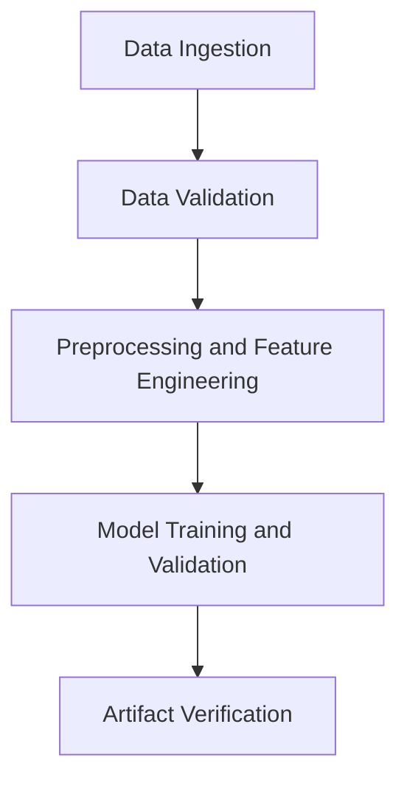

# Parking Availability Prediction Using MLOps

An end-to-end Machine Learning Operations (MLOps) project to predict parking occupancy and estimate available parking spaces using historical data from Birmingham, United Kingdom.

**Course:** ADSP 32021 — Machine Learning Operations  
**Institution:** University of Chicago  
**Team:** Emmalucia E., Alison C., Monica P.  
**Final deadline:** December 2, 2026

## Project Overview

This project aims to build an automated machine learning pipeline that forecasts parking occupancy approximately 30 minutes ahead.

The system will estimate available parking spaces using:

```text
Available spaces = Capacity − Predicted occupancy
```

Predicted occupancy will be constrained to the valid range between zero and facility capacity.

The planned MLOps workflow includes data validation, feature engineering, model training, experiment tracking, deployment, and monitoring.

For the original project scope and proposed architecture, see [Project Proposal](project_proposal.md).

## Dataset

**Source:** [UCI Machine Learning Repository — Parking Birmingham](https://archive.ics.uci.edu/dataset/482/parking+birmingham)

The dataset contains historical occupancy observations from 30 parking facilities.

| Property | Value |
|---|---|
| Original observations | 35,717 |
| Parking facilities | 30 |
| Validated observations | 35,116 |
| Forecasting examples before split exclusions | 31,327 |
| Complete-feature examples (exploratory notebook) | 25,793 |
| Forecast horizon | Approximately 30 minutes |
| Model input features | 11 |

Original columns:

- `SystemCodeNumber` — Parking facility identifier
- `Capacity` — Total parking capacity
- `Occupancy` — Occupied parking spaces
- `LastUpdated` — Observation timestamp

## Repository Structure

```text
parking-predictability/
├── artifacts/
│   ├── validation_metrics.json
│   └── pipeline_runs/              # Generated locally
├── dags/
│   └── parking_training_dag.py
├── data/
│   └── dataset.csv
├── notebooks/
│   ├── 01_data_audit.ipynb
│   ├── 02_feature_engineering.ipynb
│   └── 03_modeling.ipynb
├── scripts/
│   └── airflow_env.sh
├── src/
│   ├── data_validation.py
│   ├── feature_engineering.py
│   ├── feature_schema.py
│   ├── pipeline_tasks.py
│   └── train_models.py
├── tests/
│   ├── test_pipeline_tasks.py
│   ├── test_train_models.py
│   └── test_training_dag.py
├── requirements.txt
├── requirements-airflow.txt
├── project_proposal.md
└── README.md
```

Generated model artifacts, pipeline run directories, virtual environments, and local Airflow databases are excluded from version control. Additional deployment, experiment tracking, and monitoring components will be added as development progresses.

## Data Validation

The data validation stage checks:

- Missing values and invalid timestamps
- Duplicate observations
- Nonpositive parking capacities
- Negative occupancy values
- Occupancy exceeding facility capacity
- Consistency of capacity values within each facility

**Validation results:**

| Metric | Count |
|---|---:|
| Original records | 35,717 |
| Duplicate records removed | 216 |
| Physically invalid occupancy records removed | 385 |
| Final validated records | 35,116 |

Reusable validation logic is implemented in `src/data_validation.py`.

## Feature Engineering

The project uses a facility-specific forecasting approach.

For each observation, the prediction target is the next recorded occupancy when the next observation occurs between 25 and 35 minutes later.

Historical features are constructed using information available at prediction time.

**Model features:**

| Category | Features |
|---|---|
| Facility | `SystemCodeNumber`, `Capacity` |
| Current occupancy | `Occupancy` |
| Calendar | `hour`, `day_of_week`, `is_weekend`, `month` |
| Historical occupancy | `occupancy_lag_1`, `occupancy_lag_2`, `occupancy_change_1`, `occupancy_rolling_mean_3` |

The shared feature definitions are maintained in `src/feature_schema.py`.

Reusable feature engineering functions are implemented in `src/feature_engineering.py`.

## Chronological Data Splitting

To reduce temporal leakage, observations are divided chronologically rather than randomly. Forecast targets crossing split boundaries are excluded.

The automated training pipeline produces the following splits:

| Dataset | Before complete-feature filtering | Used for model development |
|---|---:|---:|
| Training | 22,467 | 18,627 |
| Validation | 4,143 | 3,389 |
| Test | 4,666 | Reserved for final evaluation |

Training and validation records with incomplete historical features are excluded before model fitting and evaluation. The held-out test split remains untouched.

The earlier exploratory notebook used a different filtering and splitting workflow. The counts above reflect the current reproducible training pipeline.

**Verification completed:**

- All 11 input features are available.
- Training and validation features contain no missing values after filtering.
- Target columns are excluded from model inputs.
- Forecast targets crossing chronological split boundaries are excluded.
- Temporal leakage checks pass.

## MLOps Pipeline

The project combines reusable machine learning functions with orchestration, experiment tracking, deployment, and monitoring components.

| Component | Technology | Purpose | Status |
|---|---|---|---|
| Pipeline orchestration | Apache Airflow | Automate data preparation and model training | Implemented |
| Model training | scikit-learn | Compare baseline and regression models | Implemented |
| Experiment tracking | MLflow | Record model parameters, metrics, and artifacts | Planned |
| Model serving | FastAPI | Expose a prediction endpoint | Planned |
| Containerization | Docker | Package the inference application | Planned |
| Model monitoring | Evidently AI | Detect data drift and monitor input distributions | Planned |

## Project Progress

As of November 17, 2026:

| Component | Status |
|---|---|
| Project proposal and repository setup | Completed |
| Data audit and validation | Completed |
| Feature engineering and chronological splits | Implemented and tested |
| Reusable feature schema | Implemented and tested |
| Baseline and regression models | Implemented and tested |
| Airflow pipeline | Implemented and tested |
| MLflow tracking and registration | Pending |
| FastAPI and Docker deployment | Pending |
| Monitoring and drift simulation | Pending |

## Running the Project

The project currently uses Python and pandas for data validation and feature engineering.

To explore the completed work, open the following notebooks in VS Code or Jupyter:

1. `notebooks/01_data_audit.ipynb`
2. `notebooks/02_feature_engineering.ipynb`
3. `notebooks/03_modeling.ipynb`

### Reproducible Model Training

Install the project dependencies:

```bash
python -m pip install -r requirements.txt
```

Run the baseline and regression training workflow from the repository root:

```bash
python -m src.train_models
```

This uses the chronological training and validation splits, leaves the test split untouched, and writes:

- `artifacts/linear_regression.joblib`
- `artifacts/random_forest.joblib`
- `artifacts/validation_metrics.json`

Custom input or artifact paths can be provided with `--data` and `--artifacts`.

Reusable Python functions are available in the `src/` directory.

## Automated Training Pipeline with Apache Airflow

The `parking_training` DAG orchestrates the complete model training workflow using Apache Airflow 2.11.0 and the project's shared Python functions.

### Pipeline Architecture



### Pipeline Tasks

| Task | Responsibility |
|---|---|
| `ingest_data` | Load the input CSV, check file availability, and reject empty datasets. |
| `validate_data` | Apply shared data validation rules and reject invalid input schemas. |
| `preprocess_data` | Construct historical features and forecasting targets, then create chronological training, validation, and test splits. |
| `train_models` | Train regression models, evaluate validation performance, and save model artifacts. |
| `verify_artifacts` | Verify that required model files and valid evaluation metrics were generated. |

Pipeline functions are implemented in `src/pipeline_tasks.py`, while orchestration and task dependencies are defined in `dags/parking_training_dag.py`.

The DAG passes intermediate file paths between tasks using Airflow XCom rather than transferring entire datasets through the metadata database.

### DAG Configuration

| Setting | Value |
|---|---|
| DAG ID | `parking_training` |
| Schedule | Manual execution |
| Catchup | Disabled |
| Maximum active runs | 1 |
| Task retries | 1 |
| Retry delay | 1 minute |
| Default dataset | `data/dataset.csv` |

Manual execution is appropriate for the current historical dataset. Scheduled training can be introduced when recurring data ingestion is available.

### Environment Setup

Python 3.11 is recommended for the tested Airflow environment.

From the repository root, create and activate a virtual environment:

```bash
python3.11 -m venv .venv
source .venv/bin/activate
```

Install Airflow using the official version-specific constraints:

```bash
AIRFLOW_VERSION=2.11.0
PYTHON_VERSION=3.11

CONSTRAINT_URL="https://raw.githubusercontent.com/apache/airflow/constraints-${AIRFLOW_VERSION}/constraints-${PYTHON_VERSION}.txt"

python -m pip install -r requirements-airflow.txt \
  --constraint "${CONSTRAINT_URL}"
```

Install the remaining project dependencies:

```bash
python -m pip install -r requirements.txt
python -m pip check
```

Configure the local Airflow environment and initialize its metadata database:

```bash
source scripts/airflow_env.sh
airflow db migrate
```

The environment script configures the project-specific Airflow home directory, DAG directory, and Python import path. Run it from the repository root in each new terminal session.

Verify the DAG installation:

```bash
airflow version
airflow dags list
airflow dags list-import-errors
```

### Local Development Limitations

CLI-based DAG execution and automated tests were verified on Apple Silicon using macOS and Python 3.11.

A native macOS process-forking issue involving `setproctitle` caused worker crashes when starting the standalone Airflow services. A similar issue is documented in [Apache Airflow Issue #55838](https://github.com/apache/airflow/issues/55838).

This affected standalone Airflow startup but did not prevent successful CLI-based DAG execution or automated testing.

For local development, use `airflow dags test parking_training`. Containerized Airflow execution can be evaluated during the Docker integration phase.

### Tested Environment

The automated training pipeline was developed and verified using Python 3.11.18 on Apple Silicon (macOS ARM64).

| Dependency | Tested version |
|---|---|
| Apache Airflow | 2.11.0 |
| pandas | 3.1.1 |
| NumPy | 2.4.6 |
| scikit-learn | 1.9.1 |
| joblib | 1.6.0 |
| Pendulum | 3.1.0 |

Airflow is installed separately from the shared machine learning dependencies to avoid requiring orchestration packages for standalone model training and inference development.

The versions above document the verified development environment. The shared `requirements.txt` retains minimum dependency versions to support ongoing team development.

### Running the Pipeline

Execute the complete DAG locally without starting the scheduler or webserver:

```bash
airflow dags test parking_training
```

To provide a different input dataset:

```bash
airflow dags test parking_training \
  --conf '{"data_path":"data/dataset.csv"}'
```

The input path can be absolute or relative to the repository root.

### Generated Artifacts

Each DAG run creates an isolated output directory identified by a hash of its Airflow run ID.

```text
artifacts/pipeline_runs/<run_hash>/
├── raw_data.pkl
├── validated_data.pkl
├── train.pkl
├── validation.pkl
├── test.pkl
├── preprocessing_summary.json
└── models/
    ├── linear_regression.joblib
    ├── random_forest.joblib
    └── validation_metrics.json
```

Intermediate datasets, trained models, and evaluation results are preserved separately for each run.

The pipeline currently uses local file-based storage. Intermediate pickle files and model artifacts should only be loaded from trusted sources. Generated pipeline directories are excluded from Git.

### Pipeline Verification

The complete pipeline was tested using the original historical parking dataset.

| Metric | Result |
|---|---:|
| Raw observations | 35,717 |
| Validated observations | 35,116 |
| Forecasting examples before chronological boundary exclusions | 31,327 |
| Training observations used | 18,627 |
| Validation observations used | 3,389 |
| Held-out test observations | 4,666 |
| Successful DAG execution time | Approximately 20–22 seconds |

The automated workflow reproduces the validation metrics from the standalone training implementation.

### Failure Handling

The DAG was tested under two intentional failure scenarios.

| Task | Missing dataset | Invalid schema |
|---|---|---|
| Data ingestion | Failed | Success |
| Data validation | Upstream failed | Failed |
| Preprocessing | Upstream failed | Upstream failed |
| Model training | Upstream failed | Upstream failed |
| Artifact verification | Upstream failed | Upstream failed |

To reproduce the missing-file scenario:

```bash
airflow dags test parking_training \
  --conf '{"data_path":"data/nonexistent.csv"}'
```

To reproduce the invalid-schema scenario:

```bash
mkdir -p artifacts/pipeline_runs/failure_inputs

printf 'Occupancy\n10\n20\n' \
  > artifacts/pipeline_runs/failure_inputs/invalid_schema.csv

airflow dags test parking_training \
  --conf '{"data_path":"artifacts/pipeline_runs/failure_inputs/invalid_schema.csv"}'
```

Both runs are expected to fail. Invalid input prevents downstream processing and model training. A subsequent execution using valid data completed successfully, demonstrating pipeline recovery.

### Local Development Limitations

CLI-based DAG execution and automated tests were verified on Apple Silicon using macOS and Python 3.11.

A native macOS process-forking issue involving `setproctitle` caused worker crashes when starting the standalone Airflow services. This affects the local scheduler and webserver environment rather than the verified CLI training workflow.

For local development, use `airflow dags test parking_training`. Containerized Airflow execution can be evaluated during the Docker integration phase.

## Project Documentation

- [Project Proposal](project_proposal.md) — Original objectives, architecture, timeline, and deliverables
- `notebooks/01_data_audit.ipynb` — Dataset exploration and validation
- `notebooks/02_feature_engineering.ipynb` — Forecast target construction, historical features, and chronological splitting
- `notebooks/03_modeling.ipynb` — Baseline and regression model development
- `src/train_models.py` — Reproducible model training and validation
- `src/pipeline_tasks.py` — Reusable automated training pipeline tasks
- `dags/parking_training_dag.py` — Airflow orchestration and task dependencies
- `tests/` — Automated project, pipeline, and DAG verification

## Modeling Validation Results

Using chronological validation data:

| Model | MAE | RMSE |
|---|---:|---:|
| Random Forest | 18.775141 | 33.672739 |
| Linear Regression | 20.013103 | 33.674048 |
| Persistence Baseline | 54.100620 | 93.675742 |

Random Forest was the lowest-RMSE model on validation data. The held-out test split was not used during model selection.

## Running Tests

Install the project and Airflow dependencies using the environment setup instructions above.

From the repository root, activate the virtual environment and load the Airflow configuration:

```bash
source .venv/bin/activate
source scripts/airflow_env.sh
```

Run the complete automated test suite:

```bash
python -m unittest discover -s tests -v
```

Run pipeline-specific tests:

```bash
python -m unittest discover -s tests -p "test_pipeline_tasks.py" -v
```

Run DAG configuration and dependency tests:

```bash
python -m unittest discover -s tests -p "test_training_dag.py" -v
```

### Test Coverage

| Test category | Tests passed |
|---|---:|
| Existing project tests | 4 |
| Pipeline task tests | 11 |
| Airflow DAG tests | 6 |
| Total | 21 |

The tests cover input ingestion, invalid input handling, chronological splitting, model training, artifact verification, DAG loading, task dependencies, and execution configuration.

All 21 automated tests passed. End-to-end Airflow execution was also verified separately through successful runs and intentional failure scenarios.


## Prediction API

The FastAPI service predicts parking facility occupancy approximately 30 minutes ahead using a registered MLflow model.

### Installation

From the repository root:

```bash
pip install -r requirements-api.txt
```

### Configuration

The API uses the following environment variables:

| Variable | Default | Description |
|---|---|---|
| `MLFLOW_TRACKING_URI` | `http://127.0.0.1:5001` | MLflow tracking and model registry location |
| `MODEL_URI` | `models:/parking-occupancy-random-forest/1` | Registered model to load for inference |

The specified model must be registered and accessible before making predictions.

### Start the API

```bash
uvicorn src.api:app --reload
```

Interactive API documentation is available at:

- http://127.0.0.1:8000/docs

### Endpoints

**GET `/health`**

Returns the API status and configured model URI.

**POST `/predict`**

Accepts parking facility information and historical occupancy features.

Example request:

```json
{
  "SystemCodeNumber": "BHMBCCMKT01",
  "Capacity": 100,
  "Occupancy": 70,
  "hour": 14,
  "day_of_week": 2,
  "is_weekend": 0,
  "month": 11,
  "occupancy_lag_1": 68,
  "occupancy_lag_2": 65,
  "occupancy_change_1": 2,
  "occupancy_rolling_mean_3": 67.67
}
```

Example response (illustrative):

```json
{
  "facility": "BHMBCCMKT01",
  "forecast_horizon_minutes": 30,
  "predicted_occupancy": 75.5,
  "predicted_available_spaces": 24.5,
  "capacity": 100,
  "model_uri": "models:/parking-occupancy-random-forest/1",
  "model_version": "1"
}
```

Predicted occupancy is constrained between zero and facility capacity. Available spaces are calculated by subtracting predicted occupancy from capacity.

Invalid requests return HTTP 422.

### Testing

Run the API unit tests without requiring a registered MLflow model:

```bash
python -m pytest tests/test_api.py -v
```

The tests use a mock model to verify request validation, prediction outputs, feature ordering, and clipping behavior.

### Clean held-out API validation

After starting the API, send the clean observations reserved in the chronological test split through the deployed `/predict` endpoint:

```bash
python -m scripts.validate_heldout_api \
  --api-url http://127.0.0.1:8000 \
  --output artifacts/heldout_api_metrics.json
```

The script validates and engineers the dataset, obtains the untouched test split, sends one API request per complete held-out example, and calculates MAE and RMSE against `TargetOccupancy`. It records the total available examples, request success/failure counts, and metrics in `artifacts/heldout_api_metrics.json`.

Use `--limit N` for a smaller smoke test. A full validation should not use `--limit`.

## Project Team

- Emmalucia E.
- Alison C.
- Monica P.

University of Chicago — ADSP 32021 Machine Learning Operations, Fall 2026.
