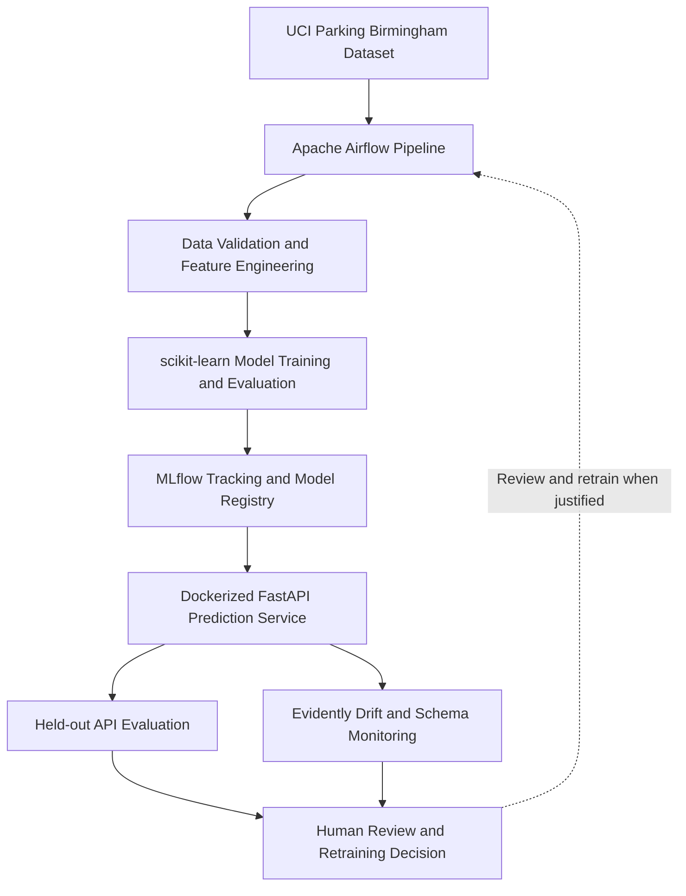
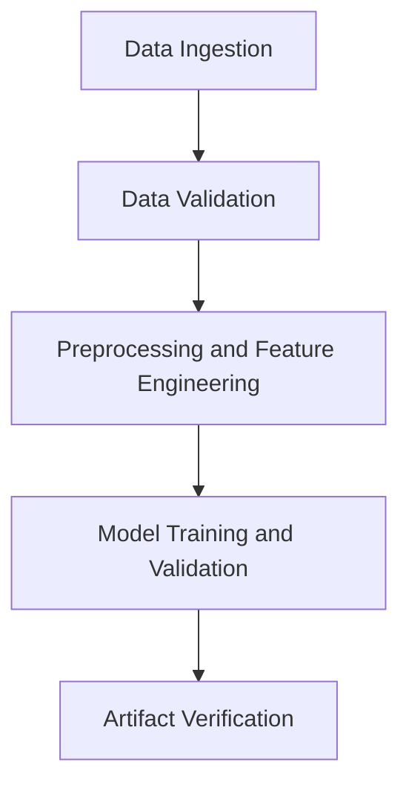
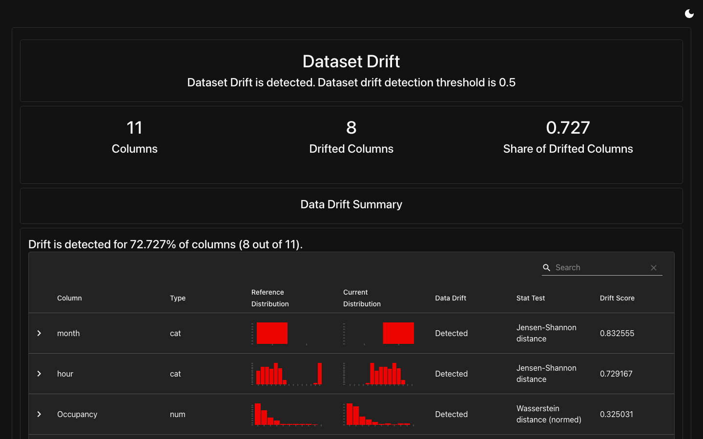

# Parking Availability Prediction Using MLOps

An end-to-end Machine Learning Operations (MLOps) project to predict parking occupancy and estimate available parking spaces using historical data from Birmingham, United Kingdom.

**Course:** ADSP 32021 — Machine Learning Operations  
**Institution:** University of Chicago  
**Team:** Emmalucia E., Alison C., Monica P.  
**Final deadline:** December 2, 2026

## Project Overview

This project implements an automated machine learning pipeline that forecasts parking occupancy approximately 30 minutes ahead.

The system will estimate available parking spaces using:

```text
Available spaces = Capacity − Predicted occupancy
```

Predicted occupancy will be constrained to the valid range between zero and facility capacity.

The implemented MLOps workflow integrates data validation, feature engineering, model training, experiment tracking, model registration, containerized inference, and monitoring. Apache Airflow orchestrates training, MLflow manages model experiments and versions, and a Dockerized FastAPI service provides predictions. Evidently AI supports drift analysis and monitoring demonstrations.

The project uses historical parking observations for approximately 30-minute-ahead forecasts. It is a reproducible prototype rather than a live parking availability service.

For the original project scope and proposed architecture, see [Project Proposal](project_proposal.md).

## Dataset

**Source:** [UCI Machine Learning Repository — Parking Birmingham](https://archive.ics.uci.edu/dataset/482/parking+birmingham)

The dataset contains historical occupancy observations from 30 parking facilities.

| Property | Value |
|---|---|
| Original observations | 35,717 |
| Parking facilities | 30 |
| Validated observations | 35,116 |
| Forecasting examples before split exclusions | 31,327 |
| Complete-feature examples (exploratory notebook) | 25,793 |
| Forecast horizon | Approximately 30 minutes |
| Model input features | 11 |

Original columns:

- `SystemCodeNumber` — Parking facility identifier
- `Capacity` — Total parking capacity
- `Occupancy` — Occupied parking spaces
- `LastUpdated` — Observation timestamp

## Repository Structure

```text
parking-predictability/
├── artifacts/
│   ├── validation_metrics.json
│   └── pipeline_runs/              # Generated locally
├── dags/
│   └── parking_training_dag.py
├── data/
│   └── dataset.csv
├── docs/
│   ├── model_loading_contract.md
│   └── monitoring/                # Monitoring evidence
├── notebooks/
│   ├── 01_data_audit.ipynb
│   ├── 02_feature_engineering.ipynb
│   └── 03_modeling.ipynb
├── scripts/
│   ├── airflow_env.sh
│   ├── simulate_drift.py
│   └── validate_heldout_api.py
├── src/
│   ├── api.py
│   ├── data_validation.py
│   ├── feature_engineering.py
│   ├── feature_schema.py
│   ├── pipeline_tasks.py
│   └── train_models.py
├── tests/
│   ├── test_api.py
│   ├── test_drift_monitoring.py
│   ├── test_heldout_api_validation.py
│   ├── test_pipeline_tasks.py
│   ├── test_registered_model.py
│   ├── test_train_models.py
│   └── test_training_dag.py
├── .dockerignore
├── .gitignore
├── Dockerfile
├── requirements.txt
├── requirements-airflow.txt
├── requirements-api.txt
├── project_proposal.md
└── README.md
```

Generated model artifacts, pipeline run directories, virtual environments, and local Airflow databases are excluded from version control. The repository also includes API deployment, experiment tracking, monitoring, and integration testing components.

## Data Validation

The data validation stage checks:

- Missing values and invalid timestamps
- Duplicate observations
- Nonpositive parking capacities
- Negative occupancy values
- Occupancy exceeding facility capacity
- Consistency of capacity values within each facility

**Validation results:**

| Metric | Count |
|---|---:|
| Original records | 35,717 |
| Duplicate records removed | 216 |
| Physically invalid occupancy records removed | 385 |
| Final validated records | 35,116 |

Reusable validation logic is implemented in `src/data_validation.py`.

## Feature Engineering

The project uses a facility-specific forecasting approach.

For each observation, the prediction target is the next recorded occupancy when the next observation occurs between 25 and 35 minutes later.

Historical features are constructed using information available at prediction time.

**Model features:**

| Category | Features |
|---|---|
| Facility | `SystemCodeNumber`, `Capacity` |
| Current occupancy | `Occupancy` |
| Calendar | `hour`, `day_of_week`, `is_weekend`, `month` |
| Historical occupancy | `occupancy_lag_1`, `occupancy_lag_2`, `occupancy_change_1`, `occupancy_rolling_mean_3` |

The shared feature definitions are maintained in `src/feature_schema.py`.

Reusable feature engineering functions are implemented in `src/feature_engineering.py`.

## Chronological Data Splitting

To reduce temporal leakage, observations are divided chronologically rather than randomly. Forecast targets crossing split boundaries are excluded.

The automated training pipeline produces the following splits:

| Dataset | Before complete-feature filtering | Used for model development |
|---|---:|---:|
| Training | 22,467 | 18,627 |
| Validation | 4,143 | 3,389 |
| Test | 4,666 | Reserved for final evaluation |

Training and validation records with incomplete historical features are excluded before model fitting and evaluation. The held-out test split remains untouched.

The earlier exploratory notebook used a different filtering and splitting workflow. The counts above reflect the current reproducible training pipeline.

**Verification completed:**

- All 11 input features are available.
- Training and validation features contain no missing values after filtering.
- Target columns are excluded from model inputs.
- Forecast targets crossing chronological split boundaries are excluded.
- Temporal leakage checks pass.

## MLOps Pipeline

The project combines reusable machine learning components with orchestration, experiment tracking, model serving, and monitoring.

| Component | Technology | Implementation status |
|---|---|---|
| Data validation and feature engineering | Python, pandas | Implemented and tested |
| Model training and evaluation | scikit-learn | Implemented and tested |
| Pipeline orchestration | Apache Airflow | Implemented and tested |
| Experiment tracking and model registry | MLflow | Implemented and tested locally |
| Prediction API | FastAPI | Implemented and tested |
| Containerized inference | Docker | Implemented and tested locally |
| Model monitoring | Evidently AI | Drift and schema-anomaly simulations completed |
| End-to-end integration | pytest, Python, HTTP API | Verified with 37 automated tests and full held-out API evaluation |

The system was validated using 3,727 held-out API requests, with no failed requests. Controlled monitoring tests detected drift in 8 of 11 input features and correctly rejected all six malformed API requests.

The prototype supports a reviewed retraining workflow; automatic model promotion and production deployment are outside the implemented scope.

## End-to-end Architecture



## Running the Project

The project uses Python 3.11 for data processing, model training, orchestration, and inference. The following notebooks document the exploratory analysis and modeling workflow.

To explore the completed work, open the following notebooks in VS Code or Jupyter:

1. `notebooks/01_data_audit.ipynb`
2. `notebooks/02_feature_engineering.ipynb`
3. `notebooks/03_modeling.ipynb`

### Reproducible Model Training

Install the project dependencies:

```bash
python -m pip install -r requirements.txt
```

Run the baseline and regression training workflow from the repository root:

```bash
python -m src.train_models
```

This uses the chronological training and validation splits, leaves the test split untouched, and writes:

- `artifacts/linear_regression.joblib`
- `artifacts/random_forest.joblib`
- `artifacts/validation_metrics.json`

Custom input or artifact paths can be provided with `--data` and `--artifacts`.

Reusable Python functions are available in the `src/` directory.

## Automated Training Pipeline with Apache Airflow

The `parking_training` DAG orchestrates the complete model training workflow using Apache Airflow 2.11.0 and the project's shared Python functions.

### Pipeline Architecture



### Pipeline Tasks

| Task | Responsibility |
|---|---|
| `ingest_data` | Load the input CSV, check file availability, and reject empty datasets. |
| `validate_data` | Apply shared data validation rules and reject invalid input schemas. |
| `preprocess_data` | Construct historical features and forecasting targets, then create chronological training, validation, and test splits. |
| `train_models` | Train regression models, evaluate validation performance, and save model artifacts. |
| `verify_artifacts` | Verify that required model files and valid evaluation metrics were generated. |

Pipeline functions are implemented in `src/pipeline_tasks.py`, while orchestration and task dependencies are defined in `dags/parking_training_dag.py`.

The DAG passes intermediate file paths between tasks using Airflow XCom rather than transferring entire datasets through the metadata database.

### DAG Configuration

| Setting | Value |
|---|---|
| DAG ID | `parking_training` |
| Schedule | Manual execution |
| Catchup | Disabled |
| Maximum active runs | 1 |
| Task retries | 1 |
| Retry delay | 1 minute |
| Default dataset | `data/dataset.csv` |

Manual execution is appropriate for the current historical dataset. Scheduled training can be introduced when recurring data ingestion is available.

### Environment Setup

Python 3.11 is recommended for the tested Airflow environment.

From the repository root, create and activate a virtual environment:

```bash
python3.11 -m venv .venv
source .venv/bin/activate
```

Install Airflow using the official version-specific constraints:

```bash
AIRFLOW_VERSION=2.11.0
PYTHON_VERSION=3.11

CONSTRAINT_URL="https://raw.githubusercontent.com/apache/airflow/constraints-${AIRFLOW_VERSION}/constraints-${PYTHON_VERSION}.txt"

python -m pip install -r requirements-airflow.txt \
  --constraint "${CONSTRAINT_URL}"
```

Install the remaining project dependencies:

```bash
python -m pip install -r requirements.txt
python -m pip check
```

Configure the local Airflow environment and initialize its metadata database:

```bash
source scripts/airflow_env.sh
airflow db migrate
```

The environment script configures the project-specific Airflow home directory, DAG directory, and Python import path. Run it from the repository root in each new terminal session.

Verify the DAG installation:

```bash
airflow version
airflow dags list
airflow dags list-import-errors
```

### Local Development Limitations

CLI-based DAG execution and automated tests were verified on Apple Silicon using macOS and Python 3.11.

A native macOS process-forking issue involving `setproctitle` caused worker crashes when starting the standalone Airflow services. A similar issue is documented in [Apache Airflow Issue #55838](https://github.com/apache/airflow/issues/55838).

This affected standalone Airflow startup but did not prevent successful CLI-based DAG execution or automated testing.

For local development, use `airflow dags test parking_training`. The FastAPI inference service has been containerized and tested separately; the Airflow scheduler and webserver have not been validated in Docker.

### Tested Environment

The automated training pipeline was developed and verified using Python 3.11.18 on Apple Silicon (macOS ARM64).

| Dependency | Tested version |
|---|---|
| Apache Airflow | 2.11.0 |
| pandas | 2.3.3 |
| NumPy | 2.4.6 |
| scikit-learn | 1.9.1 |
| joblib | 1.6.0 |
| Pendulum | 3.1.0 |

Airflow is installed separately from the shared machine learning dependencies to avoid requiring orchestration packages for standalone model training and inference development.

The versions above document the verified development environment. The shared `requirements.txt` retains minimum dependency versions to support ongoing team development.

### Running the Pipeline

Execute the complete DAG locally without starting the scheduler or webserver:

```bash
airflow dags test parking_training
```

To provide a different input dataset:

```bash
airflow dags test parking_training \
  --conf '{"data_path":"data/dataset.csv"}'
```

The input path can be absolute or relative to the repository root.

### Generated Artifacts

Each DAG run creates an isolated output directory identified by a hash of its Airflow run ID.

```text
artifacts/pipeline_runs/<run_hash>/
├── raw_data.pkl
├── validated_data.pkl
├── train.pkl
├── validation.pkl
├── test.pkl
├── preprocessing_summary.json
└── models/
    ├── linear_regression.joblib
    ├── random_forest.joblib
    └── validation_metrics.json
```

Intermediate datasets, trained models, and evaluation results are preserved separately for each run.

The pipeline currently uses local file-based storage. Intermediate pickle files and model artifacts should only be loaded from trusted sources. Generated pipeline directories are excluded from Git.

### Pipeline Verification

The complete pipeline was tested using the original historical parking dataset.

| Metric | Result |
|---|---:|
| Raw observations | 35,717 |
| Validated observations | 35,116 |
| Forecasting examples before chronological boundary exclusions | 31,327 |
| Training observations used | 18,627 |
| Validation observations used | 3,389 |
| Held-out test observations | 4,666 |
| Successful DAG execution time | Approximately 20–22 seconds |

The automated workflow reproduces the validation metrics from the standalone training implementation.

### Failure Handling

The DAG was tested under two intentional failure scenarios.

| Task | Missing dataset | Invalid schema |
|---|---|---|
| Data ingestion | Failed | Success |
| Data validation | Upstream failed | Failed |
| Preprocessing | Upstream failed | Upstream failed |
| Model training | Upstream failed | Upstream failed |
| Artifact verification | Upstream failed | Upstream failed |

To reproduce the missing-file scenario:

```bash
airflow dags test parking_training \
  --conf '{"data_path":"data/nonexistent.csv"}'
```

To reproduce the invalid-schema scenario:

```bash
mkdir -p artifacts/pipeline_runs/failure_inputs

printf 'Occupancy\n10\n20\n' \
  > artifacts/pipeline_runs/failure_inputs/invalid_schema.csv

airflow dags test parking_training \
  --conf '{"data_path":"artifacts/pipeline_runs/failure_inputs/invalid_schema.csv"}'
```

Both runs are expected to fail. Invalid input prevents downstream processing and model training. A subsequent execution using valid data completed successfully, demonstrating pipeline recovery.

## Project Documentation

- [Project Proposal](project_proposal.md) — Original objectives, architecture, timeline, and deliverables
- `notebooks/01_data_audit.ipynb` — Dataset exploration and validation
- `notebooks/02_feature_engineering.ipynb` — Forecast target construction, historical features, and chronological splitting
- `notebooks/03_modeling.ipynb` — Baseline and regression model development
- `src/train_models.py` — Reproducible model training and validation
- `src/pipeline_tasks.py` — Reusable automated training pipeline tasks
- `dags/parking_training_dag.py` — Airflow orchestration and task dependencies
- `tests/` — Automated project, pipeline, and DAG verification

## Modeling Validation Results

Using chronological validation data:

| Model | MAE | RMSE |
|---|---:|---:|
| Random Forest | 18.775141 | 33.672739 |
| Linear Regression | 20.013103 | 33.674048 |
| Persistence Baseline | 54.100620 | 93.675742 |

Random Forest was the lowest-RMSE model on validation data. The held-out test split was not used during model selection.

## Running Tests

Install the project, API, and Airflow dependencies using the environment setup instructions above.

From the repository root, activate the virtual environment and load the project-specific Airflow configuration:

```bash
source .venv/bin/activate
source scripts/airflow_env.sh
```

The Airflow configuration must be loaded in the same terminal used to run the tests. Otherwise, Airflow may use the default database in `~/airflow` rather than the project's configured database.

### Full Regression Suite

Start the local MLflow tracking server and confirm that `parking-occupancy-random-forest` version 1 is registered and accessible.

Run all automated tests:

```bash
MLFLOW_TRACKING_URI=http://127.0.0.1:5001 \
python -m pytest tests/ -v
```

**Verified result:** 37 passed, 0 failed (November 27, 2026).

The registered-model integration test requires a running MLflow server and access to the registered model's artifacts. API unit tests use mocked inference and do not require the deployed API container.

### Individual Test Suites

Run pipeline task tests:

```bash
python -m pytest tests/test_pipeline_tasks.py -v
```

Run Airflow DAG tests:

```bash
python -m pytest tests/test_training_dag.py -v
```

Run the registered-model integration test:

```bash
MLFLOW_TRACKING_URI=http://127.0.0.1:5001 \
python -m pytest tests/test_registered_model.py -v
```

### Test Coverage

| Test category | Tests passed |
|---|---:|
| Prediction API | 7 |
| Drift monitoring | 4 |
| Held-out API validation | 4 |
| Pipeline tasks | 11 |
| Registered-model inference | 1 |
| Model training | 4 |
| Airflow DAG | 6 |
| **Total** | **37** |

The tests cover data ingestion, validation, feature processing, chronological splitting, model training, artifact verification, registered-model inference, API input validation, held-out evaluation calculations, drift monitoring, and Airflow DAG configuration.

End-to-end Airflow execution, deployed API evaluation, and controlled drift simulations were also verified separately.

## Prediction API

The FastAPI service predicts parking facility occupancy approximately 30 minutes ahead using a registered MLflow model.

### Installation

From the repository root:

```bash
pip install -r requirements-api.txt
```

### Configuration

The API uses the following environment variables:

| Variable | Default | Description |
|---|---|---|
| `MLFLOW_TRACKING_URI` | `http://127.0.0.1:5001` | MLflow tracking and model registry location |
| `MODEL_URI` | `models:/parking-occupancy-random-forest/1` | Registered model to load for inference |

The specified model must be registered and accessible before making predictions.

### Start the API

```bash
uvicorn src.api:app --reload
```

Interactive API documentation is available at:

- http://127.0.0.1:8000/docs

### Endpoints

**GET `/health`**

Returns the API status and configured model URI.

**POST `/predict`**

Accepts parking facility information and historical occupancy features.

Example request:

```json
{
  "SystemCodeNumber": "BHMBCCMKT01",
  "Capacity": 100,
  "Occupancy": 70,
  "hour": 14,
  "day_of_week": 2,
  "is_weekend": 0,
  "month": 11,
  "occupancy_lag_1": 68,
  "occupancy_lag_2": 65,
  "occupancy_change_1": 2,
  "occupancy_rolling_mean_3": 67.67
}
```

Example response (illustrative):

```json
{
  "facility": "BHMBCCMKT01",
  "forecast_horizon_minutes": 30,
  "predicted_occupancy": 75.5,
  "predicted_available_spaces": 24.5,
  "capacity": 100,
  "model_uri": "models:/parking-occupancy-random-forest/1",
  "model_version": "1"
}
```

Predicted occupancy is constrained between zero and facility capacity. Available spaces are calculated by subtracting predicted occupancy from capacity.

Invalid requests return HTTP 422.

### Testing

Run the API unit tests without requiring a registered MLflow model:

```bash
python -m pytest tests/test_api.py -v
```

The tests use a mock model to verify request validation, prediction outputs, feature ordering, and clipping behavior.

### Running the API with Docker

The prediction API can run in a Docker container while connecting to an MLflow tracking server running on the host machine. The container uses Python 3.11 and installs the dependencies from `requirements-api.txt`.

**1. Build the Docker image**

From the repository root:

```bash
docker build -t parking-predictability-api:local .
```

**2. Start the MLflow tracking server**

The registered model must be available in the local MLflow Model Registry before inference.

From the repository root, activate the MLflow environment and start the server:

```bash
source .venv-mlflow/bin/activate

mlflow server \
  --host 0.0.0.0 \
  --port 5001 \
  --backend-store-uri sqlite:///mlflow.db \
  --default-artifact-root ./mlartifacts \
  --allowed-hosts "localhost,127.0.0.1,host.docker.internal,host.docker.internal:5001"
```

The `host.docker.internal` hostname allows the Docker container to reach the MLflow server on the host. The hostname with port `5001` is included in the allowlist to avoid MLflow host-header validation errors.

This configuration is intended for trusted local development. Binding MLflow to `0.0.0.0` may expose it to other devices on the network.

**3. Start the Docker container**

Open another terminal and run the following command from the repository root:

```bash
docker run --rm \
  --name parking-api \
  -p 8000:8000 \
  -e MLFLOW_TRACKING_URI=http://host.docker.internal:5001 \
  --mount "type=bind,source=$(pwd)/mlruns,target=$(pwd)/mlruns,readonly" \
  parking-predictability-api:local
```

The read-only bind mount makes the existing MLflow model artifacts accessible inside the container.

This setup assumes the registered model's artifact URI references the repository's `mlruns` directory at the same absolute path. If the repository has moved since model registration, verify the stored artifact URI before starting the container.

Model artifacts are not included in the Docker image.

**4. Verify the health endpoint**

In another terminal:

```bash
curl -i http://127.0.0.1:8000/health
```

Expected HTTP status: `200 OK`.

**5. Test model inference**

```bash
curl -i -X POST \
  http://127.0.0.1:8000/predict \
  -H "Content-Type: application/json" \
  -d '{
    "SystemCodeNumber": "BHMBCCMKT01",
    "Capacity": 500,
    "Occupancy": 250,
    "hour": 14,
    "day_of_week": 2,
    "is_weekend": 0,
    "month": 11,
    "occupancy_lag_1": 245,
    "occupancy_lag_2": 240,
    "occupancy_change_1": 5,
    "occupancy_rolling_mean_3": 245
  }'
```

A successful request returns HTTP `200 OK` with the predicted occupancy, predicted available spaces, forecast horizon, and registered model version.

**6. Stop the container**

```bash
docker stop parking-api
```

The `--rm` flag automatically removes the container after it stops.

**Troubleshooting**

- **HTTP 403 from MLflow:** Verify that `host.docker.internal:5001` is included in the MLflow server's `--allowed-hosts` setting.
- **`No such artifact` error:** Check the registered model's artifact URI and confirm that the corresponding host directory is mounted inside Docker.
- **HTTP 500 from `/predict`:** Inspect the container logs using `docker logs --tail 80 parking-api`.
- **Model loading failure:** Confirm that the registered model exists and its required serialization dependencies are installed.

This Docker configuration has been tested locally with the registered `parking-occupancy-random-forest` model, version 1. It relies on an existing host MLflow server and local model artifacts rather than packaging the model into a standalone image.

### Clean held-out API validation

After starting the API, send the clean observations reserved in the chronological test split through the deployed `/predict` endpoint:

```bash
python -m scripts.validate_heldout_api \
  --api-url http://127.0.0.1:8000 \
  --output artifacts/heldout_api_metrics.json
```

The script validates and engineers the dataset, obtains the untouched test split, sends one API request per complete held-out example, and calculates MAE and RMSE against `TargetOccupancy`. It records the total available examples, request success/failure counts, and metrics in `artifacts/heldout_api_metrics.json`.

Use `--limit N` for a smaller smoke test. A full validation should not use `--limit`.

**Verified full held-out evaluation (November 27, 2026):**

- Held-out observations: 3,727
- Successful API requests: 3,727 (100%)
- Failed requests: 0
- MAE: 18.4767
- RMSE: 34.2652
- Results saved to `artifacts/heldout_api_validation.json`.

The evaluation used the complete chronological held-out test split without a request limit.

### Drift and schema-anomaly monitoring

Install `requirements-api.txt` and start the API with its MLflow model available. Generate controlled drift evidence from the chronological held-out test split:

```bash
python -m scripts.simulate_drift \
  --api-url http://127.0.0.1:8000 \
  --drift-output artifacts/evidently_drift_report.html \
  --drift-metrics artifacts/drift_metrics.json \
  --schema-output artifacts/schema_validation_log.json
```

The script uses clean held-out features as the reference and applies seeded shifts to occupancy and calendar features. It preserves facility capacity and keeps shifted occupancy values within capacity. Six malformed payloads go to `/predict` to exercise HTTP 422 validation.

- `evidently_drift_report.html` shows dataset and per-feature drift.
- `drift_metrics.json` records the Evidently version, sample counts, and drift metrics.
- `schema_validation_log.json` records each validation response and the pass count. The command exits with status 1 if any request fails the validation check.

Use the clean held-out API validation above to measure prediction error against the observed targets.

**Verified drift and schema validation (November 27, 2026):**

- Reference observations: 3,727
- Drifted observations: 3,727
- Features with detected drift: 8 of 11 (72.7%)
- Dataset drift threshold: 50%
- Invalid API payloads correctly rejected: 6 of 6 (HTTP 422)

Generated validation evidence:

- `artifacts/drift_simulation_metrics.json`
- `artifacts/schema_validation.json`
- `artifacts/drift_simulation.json` (full generated drift report; retained locally)

The monitoring run completed successfully with no schema-validation failures.

### Retraining demonstration

The controlled monitoring run compared 3,727 clean held-out rows with 3,727 shifted rows. All shifted rows passed the request schema. Evidently flagged 8 of 11 features (72.7%), above its 50% dataset drift threshold. It flagged occupancy, both occupancy lags, occupancy change, the rolling occupancy mean, hour, day of week, and month. Capacity, facility ID, and the weekend indicator stayed below their drift thresholds.

| Signal | Evidence | Review decision |
| --- | --- | --- |
| Feature drift | [Evidently report](artifacts/evidently_drift_report.html) and [drift metrics](artifacts/drift_metrics.json) | Investigate the shift and collect representative labeled observations. |
| Prediction degradation | Compare MAE and RMSE against observed occupancy on the same labeled holdout for both the deployed model and candidate. | Use the error comparison to decide whether to promote a candidate. The synthetic shift supplies no corresponding future occupancy labels. |
| Schema errors | [Validation log](artifacts/schema_validation_log.json). FastAPI returned HTTP 422 for all six malformed requests in an in-process test with model loading stubbed. | Investigate request construction and input data quality. |



[Schema validation evidence](docs/monitoring/schema-validation.png)

#### Reproduce the training run

From the repository root, with `requirements-api.txt` installed and the MLflow server running:

```bash
MLFLOW_TRACKING_URI=http://127.0.0.1:5001 python -m src.train_models \
  --data data/dataset.csv \
  --artifacts artifacts/pipeline_runs/issue-10
```

#### Demonstration results

The demonstration logged all three runs to an isolated SQLite-backed MLflow store. It used 18,627 complete training rows and 3,389 complete validation rows from the original chronological split and reproduced the prior validation scores to two decimal places. Errors are measured in parking spaces. [Run IDs, dependency versions, and full-precision metrics](docs/monitoring/retraining-results.json)

| Model | Validation MAE | Validation RMSE |
| --- | ---: | ---: |
| Persistence baseline | 54.10 | 93.68 |
| Linear regression | 20.01 | 33.67 |
| Random forest | 18.78 | 33.67 |

On 3,727 clean held-out rows, the saved random forest candidate scored **18.48 MAE** and **34.27 RMSE** after clipping predictions to facility capacity. The persistence baseline scored **49.79 MAE** and **91.33 RMSE** on the same rows.

The random forest is the candidate for review. Before promoting it, compare its MAE and RMSE with the deployed model on the same labeled observations from the affected period, then record the teammate review and decision.

## Limitations and Future Improvements

This project demonstrates a reproducible MLOps workflow using historical parking occupancy data. Several limitations remain:

- **Historical data:** The model uses the UCI Parking Birmingham dataset rather than continuously updated parking sensor data. Performance on current parking conditions has not been established.
- **Forecast horizon:** Predictions target the next recorded observation approximately 30 minutes ahead. Irregular observation intervals limit coverage.
- **Feature availability:** Inference requires current and historical occupancy features. The API does not independently retrieve live sensor readings or construct historical features.
- **Local deployment:** Airflow, MLflow, and Docker were validated in a local development environment. Production hosting, access controls, scaling, and operational reliability have not been evaluated.
- **Monitoring:** Drift detection and schema validation were demonstrated using controlled scenarios. Continuous production monitoring and automated alerting are not implemented.
- **Retraining:** The project demonstrates retraining and model evaluation, but does not automatically promote or deploy replacement models.

Future improvements could include live data ingestion, automated feature generation, scheduled monitoring, model performance tracking with newly observed labels, and a reviewed model deployment process.

## Team Contributions

This project was developed collaboratively by three team members. The contributions below summarize the primary workstreams documented in the project's GitHub issues and pull requests.

| Team member | Primary contributions |
|---|---|
| **Alison C.** | Repository organization and integration coordination; Apache Airflow training pipeline and testing; FastAPI validation and inference improvements; Docker deployment; end-to-end reproducibility testing and documentation. |
| **Emmalucia E.** | Dataset auditing and validation; chronological data splitting; leakage-safe feature engineering and shared feature schema; MLflow experiment tracking and model registration. |
| **Monica P.** | Baseline and regression model development; model evaluation; clean held-out API validation; Evidently drift and schema-anomaly monitoring; retraining demonstration and monitoring evidence. |

All three team members contributed to project planning, integration, review, and final documentation.
