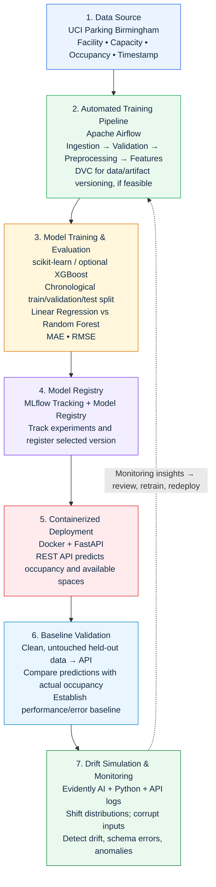

# Parking Availability Prediction — MLOps Project Proposal

**Dataset:** UCI Machine Learning Repository — Parking Birmingham  
**Internal completion target:** November 30, 2026  
**Official project deadline:** December 2, 2026  
**Team members / owners:** Emmalucia E, Alison C, Monica P
**Project status:** Proposed

## 1. Project Context and Motivation

Finding available parking spaces in busy urban areas can be challenging, contributing to traffic congestion, wasted time, and unnecessary fuel consumption. This project proposes an automated Machine Learning Operations (MLOps) pipeline to forecast parking occupancy and estimate available parking spaces using historical occupancy patterns.

We will use the **Parking Birmingham** dataset from the **UCI Machine Learning Repository**, containing approximately **35,700 observations across 30 parking facilities** in Birmingham, United Kingdom. Its key fields include parking facility identifiers, capacity, occupancy, and timestamps. These figures will be verified during initial dataset exploration.

## 2. Project Objective and Scope

**Primary objective:** Predict future parking occupancy for a specified facility and forecast horizon, then estimate available spaces:

```text
Predicted available spaces = max(0, capacity − predicted occupancy)
```

Predictions will also be capped at the facility's capacity so estimated availability remains physically plausible. The team will define a consistent prediction horizon and time granularity after examining the data.

**In scope:** Historical-data validation; time-based and lagged features; regression model comparison; automated training; experiment and model version tracking; containerized prediction API; clean-data baseline validation; simulated drift and schema anomalies; monitoring evidence; documentation and reproducibility.

**Out of scope for the initial prototype:** Live parking sensor integration, a public-facing application, and claims of production accuracy on unseen real-time traffic conditions.

## 3. Proposed MLOps Architecture

The system is organized into seven connected stages. Monitoring feeds back into data preparation and model retraining when warranted.



### Stage-by-stage implementation

| Stage | Technology | Proposed implementation / output |
| --- | --- | --- |
| **1. Data source** | UCI Parking Birmingham | Ingest historical facility-level occupancy, capacity, identifiers, and timestamps. |
| **2. Automated training pipeline** | Apache Airflow; optionally DVC | Orchestrate ingestion, validation, preprocessing, feature engineering, and scheduled training; version data/artifacts where feasible. |
| **3. Model training and evaluation** | scikit-learn; optional XGBoost | Train Linear Regression and Random Forest (with XGBoost as a stretch goal). Use chronological splits and report MAE/RMSE. |
| **4. Model registry** | MLflow | Log runs, parameters, metrics, and artifacts; register and version the selected model. |
| **5. Containerized deployment** | Docker + FastAPI | Package model and dependencies; expose a REST prediction endpoint returning predicted occupancy and estimated available spaces. |
| **6. Baseline validation** | Python API tests | Send clean, untouched held-out observations through the API; compare predictions with actual values and document baseline error. |
| **7. Drift simulation and monitoring** | Evidently AI + Python + API logs | Simulate input distribution shifts and invalid schemas; produce drift reports, validation logs, and dashboard/alert evidence. |

**Design note:** The initial feedback loop will be a *demonstrated retraining workflow*, not necessarily fully autonomous deployment. Monitoring flags a problem; the team reviews evidence, retrains, compares results, and redeploys an approved model version.

## 4. Data and Modeling Methodology

1. **Inspect and validate data.** Confirm facility count, row count, timestamp coverage, data types, duplicates, missing values, and occupancy/capacity constraints.
2. **Engineer features.** Extract hour, day of week, and other calendar features; create facility-specific lagged occupancy and rolling historical statistics using only information available at prediction time.
3. **Prevent temporal leakage.** Use chronological training, validation, and untouched test periods; avoid randomly shuffling time-series observations. Fit preprocessing on training data only.
4. **Build a reference baseline.** Compare models against a simple persistence or historical-pattern forecast to establish whether ML adds value.
5. **Train and evaluate models.** Compare Linear Regression and Random Forest; optionally test XGBoost. Report MAE and RMSE for occupancy and, where useful, available-space predictions.
6. **Track and select.** Log MLflow runs, hyperparameters, evaluation metrics, and artifacts. Register the selected model based on held-out validation performance, simplicity, and deployability.

## 5. API, Validation, and Monitoring Plan

The FastAPI service will accept a facility identifier and the features required for the defined forecast horizon. It will return predicted occupancy, predicted available spaces, and relevant model/version metadata. Inputs will be validated before inference; unavailable historical features must not be silently replaced with future observations.

For **baseline validation**, clean held-out data will be sent to the deployed API. The team will record prediction errors, request success/failure counts, and representative outputs. The test set will remain separate from training and model selection.

For **drift and reliability testing**, the team will inject controlled shifts in valid numerical inputs and separately send malformed inputs, such as missing fields, incorrect types, or invalid capacities. Evidently AI will assess distribution changes on comparable datasets, while FastAPI validation and request logs will capture schema failures. The final report will distinguish **data drift**, **prediction degradation**, and **input validation errors**, since these are not interchangeable.

## 6. Project Timeline

| Phase | Start | End | Key deliverables | Status | Owner |
| --- | --- | --- | --- | --- | --- |
| Proposal & planning | Oct 21, 2026 | Oct 25, 2026 | Submit proposal, architecture sketch, and timeline on Oct 21; create GitHub repository and assign tasks | Not Started | TBD |
| Data preparation & baselines | Oct 26, 2026 | Nov 1, 2026 | EDA, cleaning, validation, chronological split, feature engineering, baseline model | Not Started | TBD |
| Pipeline automation | Nov 2, 2026 | Nov 8, 2026 | Airflow DAG, MLflow experiment tracking, model comparison, registration | Not Started | TBD |
| Deployment | Nov 9, 2026 | Nov 15, 2026 | FastAPI prediction endpoint, Docker image, API tests | Not Started | TBD |
| Monitoring & drift tests | Nov 16, 2026 | Nov 22, 2026 | Clean test baseline, Evidently AI, corrupted test inputs, drift/error evidence | Not Started | TBD |
| Integration & documentation | Nov 23, 2026 | Nov 27, 2026 | End-to-end tests, reproducibility, README, screenshots, presentation | Not Started | TBD |
| Final review & rehearsal | Nov 28, 2026 | Nov 30, 2026 | Final system checks, 10–15 minute rehearsal, individual contribution notes | Not Started | TBD |
| Contingency / submission | Dec 1, 2026 | Dec 2, 2026 | Issue buffer and official submission | Not Started | TBD |

*These are proposed internal milestones. The Session 4 proposal is due October 21; December 1–2 is reserved as contingency.*

## 7. Task-Level Milestones

| Workstream | Task | Target date |
| --- | --- | --- |
| Proposal | Send topic, group roster, ~300-word proposal, diagram, and timeline | Oct 21, 2026 |
| Setup | Create modular GitHub repository and dependency configuration | Oct 25, 2026 |
| Data | Validate occupancy/capacity, missing values, and timestamps | Oct 29, 2026 |
| Data | Prepare lagged features and leakage-safe chronological splits | Nov 1, 2026 |
| Model | Establish baseline and MAE/RMSE comparison | Nov 1, 2026 |
| Automation | Automate ingestion, preprocessing, and training with Airflow | Nov 6, 2026 |
| Experimentation | Track MLflow runs and register selected model | Nov 8, 2026 |
| Deployment | Deploy registered model with FastAPI + Docker | Nov 15, 2026 |
| Monitoring | Send clean held-out data to API and record baseline | Nov 18, 2026 |
| Monitoring | Inject drift/schema anomalies and capture dashboard evidence | Nov 22, 2026 |
| QA | Reproduce full workflow from README | Nov 27, 2026 |
| Presentation | Prepare slides and individual contributions | Nov 27, 2026 |
| Final review | Rehearse and freeze project | Nov 30, 2026 |
| Submission | Official deadline (buffer only) | Dec 2, 2026 |

## 8. Expected Deliverables and Success Criteria

- A version-controlled GitHub repository with modular source code, dependency configuration, and setup instructions.
- A reproducible Airflow workflow covering data preparation and model training.
- An MLflow experiment history and registered, versioned model.
- A Dockerized FastAPI inference service with tested request/response schemas.
- Documented chronological evaluation, baseline comparison, MAE, and RMSE.
- Evidence of clean-data API validation and simulated drift/schema-error detection.
- Monitoring reports, API logs, architecture diagram, README, and a 10–15 minute presentation.

**Success means** demonstrating a working end-to-end pipeline, reproducible evaluation, a functioning prediction API, and observable responses to data-quality or distribution changes. Numeric accuracy and drift thresholds will be defined after exploratory analysis rather than invented in advance.

## 9. Risks and Mitigations

| Risk | Mitigation |
| --- | --- |
| Temporal leakage from lagged or rolling features | Generate features from prior observations only; enforce chronological splits and test feature availability at inference time. |
| Sparse or irregular facility observations | Inspect facility-level frequency, missing intervals, and coverage before choosing the forecast horizon. |
| Model performs no better than a simple baseline | Keep a persistence/historical baseline; prioritize sound evaluation and operational demonstration. |
| API feature mismatch between training and serving | Use a shared feature schema, request validation, and integration tests. |
| Drift tests confuse malformed data with statistical drift | Run separate scenarios for valid shifted distributions and invalid request schemas. |
| Integration delays | Prioritize a minimum viable Airflow → MLflow → FastAPI → monitoring flow; treat XGBoost, DVC, and additional dashboards as optional enhancements. |

## 10. Dataset Reference

UCI Machine Learning Repository, **Parking Birmingham**: https://archive.ics.uci.edu/dataset/482/parking+birmingham

*Dataset counts and coverage are approximate planning assumptions pending validation during EDA.*
